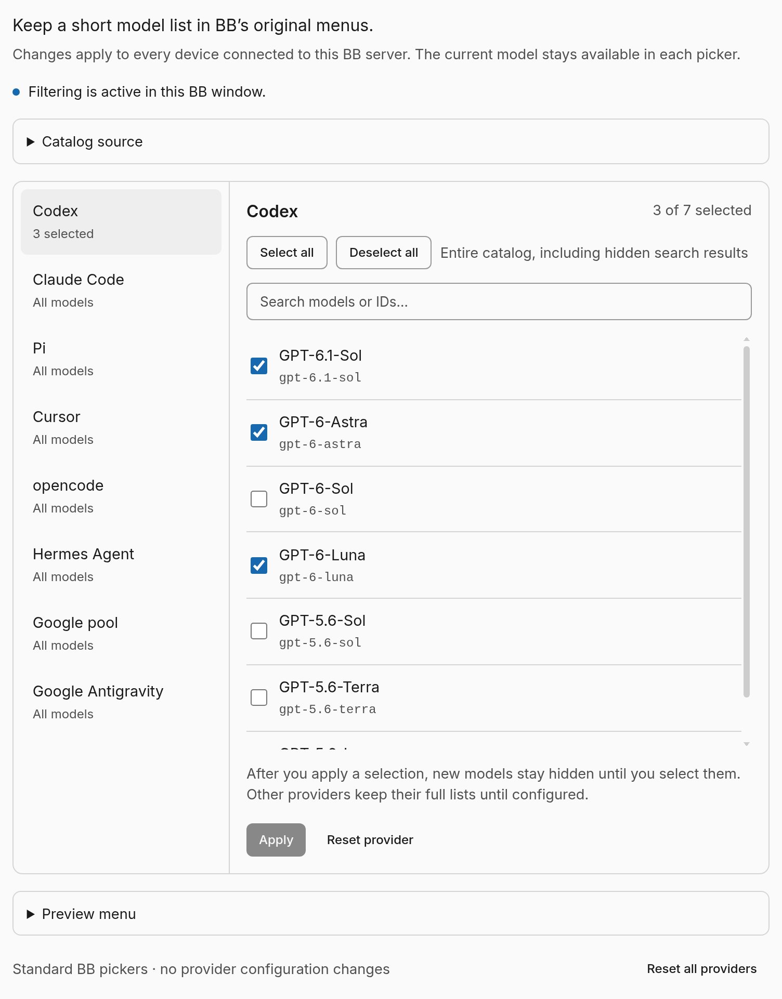
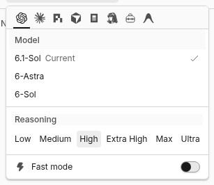

# Model Filter

[](https://github.com/werserk/bb-plugin-model-filter/actions/workflows/ci.yml)

Choose which models appear in BB's standard model pickers while keeping each picker's current model available.

Open **Settings → Installed plugins → Model Filter** to edit a provider's model list. Providers start in **All models** mode. In **Selected models** mode, new model IDs stay hidden until you select them. A hidden model that is already current remains available to that picker, marked **(Current)**, with its native reasoning and session metadata.

Preferences live in this plugin's SQLite database on the current BB server. Connected clients share the saved selection; independent BB servers have separate preferences. The plugin adds no external service or credential setting. Filtering affects picker choices, not provider authorization, billing, or model access through CLI/API calls.





## Compatibility

The verified integration target is **BB 0.47.1 / Plugin SDK 0.6.79**. The manifest bounds the supported BB release series and pins the build SDK.

Settings, storage, catalog reads, RPC, and realtime use the public Plugin SDK. Native picker filtering also needs a version-scoped adapter: it finds the shared query client through private React runtime fields and composes TanStack Query observer projections. This is not a documented public BB extension hook. It imports no BB private modules and edits no BB installation files.

If the adapter cannot identify a compatible query client, BB's full native choices remain available and the settings page reports that filtering is inactive. Recheck the native picker and restoration behavior after updating BB. See [compatibility evidence and remaining checks](docs/compatibility.md).

## Installation

This is a private review repository. GitHub access is required; no npm release or Community marketplace listing is published. Use a supported Node.js version for BB 0.47.1: Node 22.19+, 24, or 26.

Install from the repository with authenticated Git access on the BB server:

```bash
bb plugin install git:https://github.com/werserk/bb-plugin-model-filter.git@main
```

For a local development checkout, follow the steps below.

Install the locked dependencies:

```bash
npm ci --ignore-scripts
```

Build the plugin:

```bash
npm run build
```

Register the local checkout in BB:

```bash
bb plugin install .
```

After changing source, build again and reload:

```bash
bb plugin reload model-filter
```

For an installed checkout, `bb plugin dev` provides the rebuild/reload loop.

## Settings

Choose a provider, switch to **Selected models**, select model IDs, and apply. Model labels are shown alongside their opaque IDs so aliases and identical labels remain distinct. An unavailable saved ID can remain in a selection when at least one selected model is currently available.

**All models** keeps the remembered selection. **Reset provider** removes one provider's rule; **Reset all providers** removes every rule. The **Enable model filtering** plugin setting restores native choices when disabled and keeps saved preferences for later.

Each save checks the server revision. If another client saved first, the editor preserves your draft and offers the latest saved selection instead of overwriting it silently.

The collapsed **Preview menu** uses BB's actual hosted picker. Its selections only change the preview.

## CLI

Inspect the saved snapshot:

```bash
bb model-filter status --json
```

Choose model IDs for one provider, using IDs from the raw BB provider catalog:

```bash
bb model-filter select codex gpt-6-astra gpt-6-sol
```

Restore its full catalog while remembering the selection:

```bash
bb model-filter all codex
```

Remove one provider's saved rule:

```bash
bb model-filter reset codex
```

Omit the provider from `reset` to remove all rules. Every command supports `--json`. CLI writes use the same revision-checked store as the settings editor.

## Development checks

Backend tests use a real temporary SQLite database. Build its test dependency after installing dependencies:

```bash
npm rebuild better-sqlite3 --ignore-scripts=false
```

The package explicitly permits the `better-sqlite3` install script. Other install scripts remain disabled during dependency installation.

```bash
npm run format:check
```

```bash
npm run typecheck
```

```bash
npm run check:sdk
```

```bash
npm test
```

```bash
npm run build
```

CI runs these checks against the lockfile. The SDK scanner checks source imports and declared dependencies; passing it does not make the private React/TanStack adapter a supported public hook. Live verification must cover native menus, current-model exceptions, raw cached catalogs, multiple clients, and disable/reload restoration.

See [architecture](docs/ARCHITECTURE.md), [implementation and acceptance](docs/implementation.md), and [changelog](CHANGELOG.md). Runtime-shimmed React and UI utility packages stay in development dependencies; bundled code depends on Zod and the non-portaling Radix Slot primitive. The vendored Button and Input retain their local source.

## Repository and license

The primary branch is `main`. Pull requests and pushes run the checks defined in [.github/workflows/ci.yml](.github/workflows/ci.yml). The private repository is available for owner review; it has no open-source license. See [LICENSE](LICENSE).
